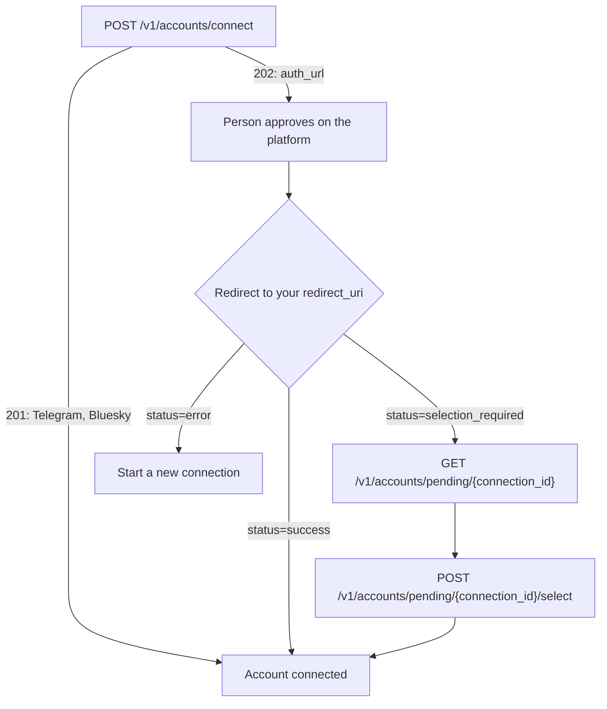

A connected account is one social account (an Instagram account, a Facebook login with its Pages, a YouTube channel, a Telegram bot) that SocialAPI can act on for you. You start a connection with `POST /v1/accounts/connect`, send the person to the platform's consent screen, and SocialAPI redirects them back to your app with the new account's ID. SocialAPI keeps the platform's access tokens, so you never receive or refresh them.

The same flow serves every platform. Telegram and Bluesky skip the consent screen and connect in one request. Google Business Profile can pause so you choose which location to connect. Facebook connects every Page at once, and you can assign Pages to brands afterwards (see [Facebook](/platforms/facebook)). Connecting, reconnecting, and disconnecting cost no credits.

## Endpoints

| Method | Path | Description |
|---|---|---|
| `POST` | `/v1/accounts/connect` | Start a connection, or reconnect an existing account |
| `GET` | `/v1/accounts` | List your connected accounts and their status. Filter to one brand with `brand_id` |
| `GET` | `/v1/accounts/pending/{connection_id}` | Read a connection that waits for you to choose a location |
| `POST` | `/v1/accounts/pending/{connection_id}/select` | Choose the location and finish the connection |
| `POST` | `/v1/oauth/exchange` | Finish a connection whose authorization code your own page received |
| `PATCH` | `/v1/accounts/{id}` | Change the account's permissions: see [Account permissions](/guides/permissions) |
| `DELETE` | `/v1/accounts/{id}` | Disconnect an account |
| `POST` | `/v1/invites` | Create a single-use link that lets someone else connect an account to a brand |
| `GET` | `/v1/invites` | List a brand's invite links. Requires `brand_id` |
| `DELETE` | `/v1/invites/{id}` | Revoke an invite link |

## Your first connection

This request starts connecting an Instagram account into an existing brand and asks SocialAPI to send the person back to your app afterwards:

```bash
curl -X POST https://api.social-api.ai/v1/accounts/connect \
  -H "Authorization: Bearer $SOCAPI_KEY" \
  -H "Content-Type: application/json" \
  -d '{
    "platform": "instagram",
    "brand_id": "1c9f6f0e-2b3a-4c5d-8e7f-0a1b2c3d4e5f",
    "redirect_uri": "https://app.example.com/oauth/callback",
    "state": "session_abc123"
  }'
```

Response (HTTP 202):

```json
{
  "auth_url": "https://www.instagram.com/oauth/authorize/?client_id=1234567890&redirect_uri=https%3A%2F%2Fapi.social-api.ai%2Foauth%2Fcallback%2Finstagram&response_type=code&state=4a8f2c1e9b3d7f06a5c2e8b4d1f3a7e2#weblink",
  "state": "4a8f2c1e9b3d7f06a5c2e8b4d1f3a7e2",
  "message": "Open this link to connect your instagram account. Once you've authorized, the account will be connected automatically."
}
```

Send the person to `auth_url`. After they approve, their browser lands on your `redirect_uri`:

```text
https://app.example.com/oauth/callback?account_id=acc_01HZ9X3Q4R5M6N7P8V2K0W1J&platform=instagram&state=session_abc123&status=success
```

Store `account_id` against your user. The account is usable at once.

### Request fields

| Field | Type | Required | Description |
|---|---|---|---|
| `platform` | string | Yes | The platform slug. See [Platform slugs](#platform-slugs) |
| `brand_id` | string | No | The brand to connect the account into. Without it, SocialAPI creates a new brand named after the account, and the new brand counts against your plan's brand allowance |
| `redirect_uri` | string | No | Where SocialAPI sends the person after the consent screen. See [Redirect URI rules](#redirect-uri-rules). Without it, the person sees a SocialAPI page that says the account is connected (or why it failed). Platforms that connect without a consent screen ignore it |
| `state` | string | No | Your own value, up to 512 characters, returned unchanged on the redirect. Use it to match the redirect to the session that started it |
| `permissions` | array of strings | No | The [permissions](/guides/permissions#the-permissions) to request: `posts.read`, `posts.write`, `comments.read`, `comments.write`, `messages.read`, `messages.write`, `reviews.read`, `reviews.write`, `analytics.read`. Omit it to keep the brand's current selection for this platform, or to request every permission when the brand has none. An empty list returns `400 validation.permissions_empty`, and an unknown name returns `400 validation.permission_unknown` |
| `metadata` | object | No | Platform-specific connect options, documented on each platform's page: `bot_token` for Telegram, `identifier`, `app_password`, and `auth_factor_token` for Bluesky, `connection_type` for [TikTok](/platforms/tiktok#creator-connection), and `connection_type: "facebook_login"` for [Instagram](/platforms/instagram#connect-through-facebook-login) |

### Response fields

`POST /v1/accounts/connect` answers in one of two ways:

- **HTTP 202** for platforms with a consent screen: `auth_url` (send the person there), `state` (SocialAPI's own value for this connection, needed only for [`POST /v1/oauth/exchange`](#finish-a-connection-from-your-own-page)), and `message`. For WhatsApp, `metadata` carries the values your page needs to open Meta's signup popup, and `auth_url` is empty. See [WhatsApp](/platforms/whatsapp).
- **HTTP 201** for Telegram and Bluesky, which connect without a consent screen: `account_id`, `platform`, `username`, and `display_name`.

The person has 1 hour from your request to finish on the platform. After 1 hour, the platform's redirect reaches a SocialAPI error page instead of your `redirect_uri`, and you start a new connection.

## How a connection works

A connection either completes at once, pauses for a choice of location, or fails. Every outcome reaches your `redirect_uri` as query parameters.



<Steps>
  <Step title="Start the connection">
    Call `POST /v1/accounts/connect` from your server with your API key. Pass the `brand_id` the account belongs in.
  </Step>
  <Step title="Send the person to the consent screen">
    Redirect the person's browser to `auth_url`. They sign in to the platform and approve the scopes SocialAPI asks for. Each platform's page lists those scopes.
  </Step>
  <Step title="Read the result on your redirect URI">
    SocialAPI completes the authorization with the platform and redirects the person to your `redirect_uri` with `status` and the parameters below. Check `status` first, then compare `state` with the value you sent.
  </Step>
  <Step title="Choose a Google Business Profile, if asked">
    When `status` is `selection_required`, no account exists yet. Read the candidates and choose within 30 minutes, as described in [Choose a Google Business Profile](#choose-a-google-business-profile).
  </Step>
</Steps>

### Redirect parameters

| Parameter | When it is present | Description |
|---|---|---|
| `status` | Always | `success`, `selection_required`, or `error` |
| `platform` | Always | The platform slug, for example `instagram` |
| `state` | When you sent `state` | Your value, unchanged |
| `account_id` | `success` with one account | The connected account's SocialAPI ID |
| `account_ids` | `success` with more than one account | Comma-separated SocialAPI IDs, when one authorization connects more than one account, for example a Google login with more than one YouTube channel |
| `connection_id` | `selection_required` | The pending connection to finish with `POST /v1/accounts/pending/{connection_id}/select` |
| `error` | `error` | The reason, see below |
| `error_description` | `error`, when there is one | A sentence you can show the person |

`error` holds one of these values:

- **The platform's own code** when the person declines or the platform refuses the request, for example `access_denied`.
- **A `platform.*` or other SocialAPI error code** when the platform or SocialAPI refuses the connection, for example `billing.brands_limit` (your plan's brand allowance is used up), `account.already_linked` (the brand already holds a different account on this platform), `account.different_login` (the brand's Facebook is connected through a different login), `byok.credentials_missing` (no X app credentials saved), `byok.credentials_invalid` (X rejected the saved credentials), or `byok.app_access_denied` (X refused your app access to its API). Each code is listed in [Errors](/guides/errors).
- **`missing_code`** when the platform returned neither a code nor an error.
- **`exchange_failed`** when the failure has no code.

After any error, start a new connection: the old `auth_url` is spent.

Without a `redirect_uri`, a connection that needs a choice sends the person to the SocialAPI dashboard, which asks them to choose.

## Platform slugs

The `platform` field takes one of these values:

| Slug | Platform | How it connects |
|---|---|---|
| `instagram` | Instagram | Consent screen |
| `facebook` | Facebook Page | Consent screen. Every granted Page that none of your other brands holds is connected (see [Facebook Pages](#facebook-pages)) |
| `threads` | Threads | Consent screen |
| `google` | Google Business Profile | Consent screen, then a choice of location when the login manages more than one |
| `tiktok` | TikTok | Consent screen |
| `linkedin` | LinkedIn | Consent screen |
| `twitter` | X / Twitter | Consent screen through your own X app. `x` is accepted as the same slug |
| `youtube` | YouTube | Consent screen |
| `pinterest` | Pinterest | Consent screen |
| `zalo` | Zalo | Consent screen |
| `whatsapp` | WhatsApp | Meta's signup popup on your page, then `POST /v1/oauth/exchange` |
| `telegram` | Telegram | One request with a bot token, no consent screen |
| `bluesky` | Bluesky | One request with an app password, no consent screen |

A slug not in this table, including `trustpilot`, returns `403 billing.platform_not_available`. Which app each platform connects through (SocialAPI's or your own) is listed in [Platform apps](/guides/platform-credentials).

## Redirect URI rules

Your `redirect_uri` must use `http` or `https` and must not contain a user name, a password, or a `#fragment`. A malformed value returns `400 validation.redirect_uri_invalid_format`.

Until you register a redirect URI, SocialAPI accepts any well-formed `redirect_uri`. Once you register one or more, every `redirect_uri` must match one of them, and any other value returns `400 validation.redirect_uri_not_whitelisted` before a connection starts. Register up to 20 redirect URIs in the dashboard at [app.social-api.ai/api-configuration](https://app.social-api.ai/api-configuration?tab=redirect-uris). Deleting every registered URI accepts any well-formed value again.

SocialAPI compares redirect URIs after normalizing both sides: the scheme and host are lowercased, a default port (`:443` for `https`, `:80` for `http`) is dropped, a trailing `/` is removed, and query parameters are sorted. `https://App.example.com:443/oauth/callback/` matches a registered `https://app.example.com/oauth/callback`.

Your `redirect_uri` can carry its own query parameters. SocialAPI adds its parameters to them. When one of yours has the same name as a parameter SocialAPI sends (`status`, `platform`, `state`, `account_id`, `account_ids`, `connection_id`, `error`, `error_description`), SocialAPI's value replaces yours.

## Choose a Google Business Profile

A Google connection pauses with `status=selection_required` when the Google login manages more than one Business Profile. You choose exactly one. A login with a single Profile connects at once.

The redirect carries only the `connection_id`. Read the candidates with `GET /v1/accounts/pending/{connection_id}`:

```bash
curl https://api.social-api.ai/v1/accounts/pending/pc_4a8f2c1e9b3d7f06a5c2e8b4d1f3a7e2 \
  -H "Authorization: Bearer $SOCAPI_KEY"
```

Response (HTTP 200):

```json
{
  "connection_id": "pc_4a8f2c1e9b3d7f06a5c2e8b4d1f3a7e2",
  "platform": "google",
  "expires_at": "2026-10-13T09:30:00Z",
  "profiles": [
    {
      "platform_account_id": "accounts/123/locations/456",
      "display_name": "Joe's Pizza (Downtown)",
      "username": "",
      "profile_picture_url": "",
      "bio": "Wood-fired pizza since 1998"
    },
    {
      "platform_account_id": "accounts/123/locations/789",
      "display_name": "Joe's Pizza (Uptown)",
      "username": "",
      "profile_picture_url": "",
      "bio": ""
    }
  ],
  "login_id": "cred_01J8X3Q4R5M6N7P8V2K0W1JA"
}
```

Finish the connection by sending the chosen `platform_account_id`:

```bash
curl -X POST https://api.social-api.ai/v1/accounts/pending/pc_4a8f2c1e9b3d7f06a5c2e8b4d1f3a7e2/select \
  -H "Authorization: Bearer $SOCAPI_KEY" \
  -H "Content-Type: application/json" \
  -d '{"platform_account_id": "accounts/123/locations/456"}'
```

Response (HTTP 201):

```json
{
  "account_id": "acc_01HZ9X3Q4R5M6N7P8V2K0W1J",
  "platform": "google",
  "username": "",
  "display_name": "Joe's Pizza (Downtown)"
}
```

### Pending connection fields

| Field | Description |
|---|---|
| `connection_id` | The pending connection's ID |
| `platform` | `google` |
| `expires_at` | When the pending connection expires, 30 minutes after it was created |
| `profiles[]` | The Business Profiles the login manages, each with `platform_account_id`, `display_name`, `username`, `profile_picture_url`, and `bio` |
| `login_id` | The Google login behind the connection. Use it to connect more locations later without a new consent screen: see [Google Business Profile locations](/platforms/google/locations) |

### Selection rules

- **A pending connection expires 30 minutes after it is created** and works once. The first successful `select` consumes it. A second `select`, or a call after expiry, returns `404 resource.not_found`.
- **A `400` keeps the pending connection.** Fix the request and send it again within the 30 minutes.
- **A `platform_account_id` that is not in `profiles[]`** returns `400 validation.profile_not_in_set`.
- **A body without `platform_account_id`** returns `400 validation.field_required`.

## Facebook Pages

A Facebook connection has no selection step. SocialAPI adds every Page the login granted that none of your other brands holds to the brand's Facebook account, and the redirect carries `status=success`.

- A login that grants no Page ends with `status=error` and `error=platform.facebook.no_pages` on your `redirect_uri`.
- A login whose every Page belongs to another of your brands ends with `status=error` and `error=platform.facebook.no_assignable_pages` on your `redirect_uri`.

To assign a Page to another brand after connecting, see [Facebook](/platforms/facebook).

### When reconnecting Facebook removes Pages

Facebook grants Page access per app, not per brand. When a person reconnects a Facebook login and unchecks a Page on Facebook's consent screen, every brand that used that Page through this login loses it. The affected account gets `status: reconnect_recommended` with `reconnect_reason: page_access_lost`. The Page stays assigned to its brand. When the login grants the Page again (the person reconnects and keeps the Page checked), the Page works again on the same brand with no further step.

## Finish a connection from your own page

`POST /v1/oauth/exchange` finishes a connection when your page, not SocialAPI, receives the authorization code. WhatsApp works this way: your page opens Meta's signup popup and receives the code. The [WhatsApp](/platforms/whatsapp) page has the full sequence.

```bash
curl -X POST https://api.social-api.ai/v1/oauth/exchange \
  -H "Authorization: Bearer $SOCAPI_KEY" \
  -H "Content-Type: application/json" \
  -d '{
    "platform": "whatsapp",
    "code": "AQDtbPB9XkLm2",
    "metadata": {
      "state": "4a8f2c1e9b3d7f06a5c2e8b4d1f3a7e2",
      "waba_id": "102290129340398",
      "phone_number_id": "106540352242922"
    }
  }'
```

Response (HTTP 201):

```json
{
  "account_id": "acc_01HZ9X3Q4R5M6N7P8V2K0W1J",
  "platform": "whatsapp",
  "username": "+1 555-010-0199",
  "display_name": "Acme Support"
}
```

- `metadata.state` is the `state` that `POST /v1/accounts/connect` returned. It works once, for 1 hour, and only with the API key that started the connection. An unknown, expired, or used `state` returns `400 validation.state_invalid`. A `state` started with a different API key returns `403 auth.state_mismatch`.
- A missing `platform` or `code` returns `400 validation.field_required`, and so does a missing `metadata.state`.
- When one authorization connects more than one account, the response (HTTP 201) is `{"data": [...], "count": 2}` with one entry per account.
- When the connection needs a choice, the response is HTTP 200 with `"status": "selection_required"`, the `connection_id`, and the same `profiles` and `login_id` fields as `GET /v1/accounts/pending/{connection_id}`.

## Account status

`GET /v1/accounts` returns every connected account with its `status`:

```bash
curl "https://api.social-api.ai/v1/accounts?brand_id=1c9f6f0e-2b3a-4c5d-8e7f-0a1b2c3d4e5f" \
  -H "Authorization: Bearer $SOCAPI_KEY"
```

Response (HTTP 200):

```json
{
  "data": [
    {
      "id": "acc_01HZ9X3Q4R5M6N7P8V2K0W1J",
      "platform": "instagram",
      "name": "Acme Corp",
      "username": "acmecorp",
      "profile_picture_url": "https://scontent.cdninstagram.com/v/t51.2885-19/acmecorp.jpg",
      "bio": "Wood-fired bread since 1998",
      "brand_id": "1c9f6f0e-2b3a-4c5d-8e7f-0a1b2c3d4e5f",
      "status": "reconnect_recommended",
      "reconnect_reason": "platform_unauthorized",
      "permissions": null,
      "effective_permissions": ["posts.read", "posts.write", "comments.read", "comments.write", "messages.read", "messages.write", "analytics.read"]
    }
  ],
  "count": 1
}
```

| Field | Description |
|---|---|
| `id` | The account's SocialAPI ID, prefixed `acc_` |
| `platform` | The platform slug |
| `name`, `username` | The account's display name and handle. On platforms without a handle, `username` equals `name` |
| `profile_picture_url`, `bio` | The account's picture and biography. Absent when the platform gives none |
| `brand_id` | The brand that holds the account |
| `status` | `active`, `reconnect_recommended`, or `token_expired`, see below |
| `reconnect_reason` | Why the account needs reconnecting. Absent when `status` is `active` or when SocialAPI has no reason to give |
| `login_id` | The platform login shared by every account connected in the same authorization. Present for Facebook and Google accounts |
| `permissions` | The [permissions](/guides/permissions) requested for this account. `null` means every permission, including ones added later. Always present |
| `effective_permissions` | The permissions the account can use now: the requested ones that the platform supports and the person connecting granted. An empty list when none apply. Always present |

| `status` | What it means | What to do |
|---|---|---|
| `active` | The account works | Nothing |
| `reconnect_recommended` | The platform refused a request, or the account lost access to something it used. Requests on the account still go through | Ask the person to reconnect. Check `reconnect_reason` first: some reasons are not fixed by a reconnect |
| `token_expired` | The platform said the stored authorization is no longer valid. Every request that acts on the account returns `403 account.reconnection_required` | Reconnect the account |

Treat a `reconnect_reason` you do not recognize as a request to reconnect.

| `reconnect_reason` | Cause |
|---|---|
| `platform_unauthorized` | The platform refused a request as unauthorized without saying why. The account returns to `active` by itself after its next successful request |
| `access_revoked` | The person removed SocialAPI's access on the platform, or removed the scopes it needs |
| `all_pages_removed` | The login no longer grants any of the Pages this account used |
| `page_access_lost` | A reconnect of the same Facebook login unchecked a Page this account used |
| `posts_sync_auth_failed` | The platform refused a read of the account's posts as unauthorized |
| `youtube_account_suspended` | YouTube suspended the channel. Reconnecting does not lift a suspension: the channel owner resolves it with YouTube |
| `whatsapp_number_unavailable` | Meta reports that the WhatsApp number can no longer be used through this connection |
| `whatsapp_number_banned` | Meta banned the WhatsApp number. Reconnecting does not lift a ban: a connection to that number returns `403 whatsapp.number_banned` until Meta lifts it |
| `password_changed`, `session_expired`, `invalid_access_token`, `app_not_installed`, `user_checkpointed`, `checkpoint_required`, `user_not_confirmed` | Instagram, Facebook, or Threads ended the authorization, for the reason named. The person signs in to the platform, resolves any security check, then reconnects |

## Reconnect an account

To reconnect an account, call `POST /v1/accounts/connect` again with the same `platform` and the account's current `brand_id` (the `brand_id` that `GET /v1/accounts` returns), and send the person through the consent screen with the same platform login:

```bash
curl -X POST https://api.social-api.ai/v1/accounts/connect \
  -H "Authorization: Bearer $SOCAPI_KEY" \
  -H "Content-Type: application/json" \
  -d '{
    "platform": "instagram",
    "brand_id": "1c9f6f0e-2b3a-4c5d-8e7f-0a1b2c3d4e5f",
    "redirect_uri": "https://app.example.com/oauth/callback"
  }'
```

SocialAPI updates the existing account in place:

- The account keeps its `id`, its brand, its posts, conversations, and Automations.
- `status` returns to `active` and `reconnect_reason` is cleared.
- The account keeps its `permissions` unless you send `permissions` on the reconnect. A narrower list deletes the data the removed permissions covered: see [Removing a permission deletes data](/guides/permissions#removing-a-permission-deletes-data).
- SocialAPI sends `account.connected` again.

Always pass `brand_id` when you reconnect. Without it, SocialAPI creates a new brand for the connection and moves the account into it, which leaves the old brand without the account.

Connecting a platform account that another of your brands already holds moves it to the brand you name. These cases do not move it:

- **Facebook, and Instagram connected through Facebook Login.** A Page or Instagram account that another of your brands holds is not taken. A login whose every Page or Instagram account belongs to another brand ends with `error=platform.facebook.no_assignable_pages` or `error=platform.instagram.no_assignable_pages`. You assign Pages to brands as described in [Facebook](/platforms/facebook).
- **Google Business Profile locations assigned with the assign call.** `POST /v1/platforms/google/logins/{loginId}/locations/{locationId}/assign` returns `400 validation.location_already_assigned` for a location that another brand holds. See [Google locations](/platforms/google/locations).
- **`lock_accounts_to_brand` set to `true` on your SocialAPI account** (`PATCH /v1/users/me`). A connect that would move an account to a different brand ends with `error=account.already_linked`, or returns `409 account.already_linked`. The default is `false`. The lock does not apply to Facebook.

Each of those errors leaves the account in its current brand.

A brand holds one connected account per platform. Connecting a different account of the same platform into a brand that already has one ends with `status=error` and `error=account.already_linked` on your `redirect_uri`. Telegram and Bluesky, which connect in one request, return `409 account.already_linked` from `POST /v1/accounts/connect`, and so does `POST /v1/accounts/pending/{connection_id}/select` for a Google location. On Facebook, connecting a brand whose account came from a different Facebook login ends with `error=account.different_login` on your `redirect_uri`.

A Google login with more than one YouTube channel connects every channel in one authorization, and the redirect carries every account in `account_ids`. Without `brand_id`, each channel connects into its own new brand named after the channel. With a `brand_id`, the brand takes one channel, and each further channel ends the connection with `status=error` and `error=account.already_linked` on your `redirect_uri`. Channels connected before the error stay connected.

## Let someone else connect an account

An invite link lets a person who has no access to your SocialAPI account connect their own account to one of your brands. Agencies send it to clients. The link works once.

```bash
curl -X POST https://api.social-api.ai/v1/invites \
  -H "Authorization: Bearer $SOCAPI_KEY" \
  -H "Content-Type: application/json" \
  -d '{
    "brand_id": "1c9f6f0e-2b3a-4c5d-8e7f-0a1b2c3d4e5f",
    "platform": "facebook",
    "expires_in_days": 7
  }'
```

Response (HTTP 201):

```json
{
  "id": "3f6c1a52-9d4e-4b7a-8c21-5e0f7a9b1d34",
  "platform": "facebook",
  "token": "a55755cf75f73b56deb3dfe0c993fd36fc4c2bfa7e1d94c60b8a3f52d17e9c40",
  "url": "https://api.social-api.ai/invite/a55755cf75f73b56deb3dfe0c993fd36fc4c2bfa7e1d94c60b8a3f52d17e9c40",
  "expires_at": "2026-10-20T09:00:00Z",
  "permissions": null
}
```

Send `url` to the person. They approve on the platform's consent screen, SocialAPI connects the account to the brand, and `account.connected` is sent to your webhook endpoints.

| Field | Type | Required | Description |
|---|---|---|---|
| `brand_id` | string | Yes | The brand that receives the account |
| `platform` | string | Yes | A platform slug that connects through a consent screen, or `whatsapp` |
| `expires_in_days` | integer | Yes | `1`, `3`, `7`, `14`, or `30`. Any other value returns `400 validation.field_invalid` |
| `permissions` | array of strings | No | The [permissions](/guides/permissions#the-permissions) the connected account gets. Omit it to keep the brand's current selection for this platform, or to give every permission when the brand has none. An empty list returns `400 validation.permissions_empty`, and an unknown name returns `400 validation.permission_unknown`. The response and the invite list return it as you set it, `null` when you omitted it |

- A `brand_id` that is not one of your brands returns `404 resource.not_found`.
- A brand that already holds an account on that platform, or that already has an unused, unexpired invite for that platform, returns `409 resource.conflict`.
- A Facebook invite connects every Page of the person's login that none of your other brands holds. The person cannot choose Pages.
- An expired, used, or revoked link shows the person a SocialAPI error page.
- `GET /v1/invites?brand_id={brand_id}` lists the brand's invites, newest first, each with `id`, `platform`, `token`, `url`, `is_active`, `expires_at`, `created_at`, and `permissions`. A missing `brand_id` returns `400 validation.field_required`.
- `DELETE /v1/invites/{id}` revokes an invite and returns HTTP 204 with no body. An unknown or already used invite returns `404 resource.not_found`.

Creating, listing, and revoking invites needs a full-access key or the dashboard, and costs no credits.

## Disconnect an account

`DELETE /v1/accounts/{id}` disconnects an account:

```bash
curl -X DELETE https://api.social-api.ai/v1/accounts/acc_01HZ9X3Q4R5M6N7P8V2K0W1J \
  -H "Authorization: Bearer $SOCAPI_KEY"
```

Response: HTTP 204 with no body. An ID that is not one of your accounts returns `404 account.not_found`.

<Warning>
  Disconnecting cannot be undone. Connecting the same platform account again creates a new account with a new `id`, and nothing below comes back.
</Warning>

Disconnecting an account:

- **Removes the account.** It no longer appears in `GET /v1/accounts`, and every request with its ID returns `404 account.not_found`. Its brand stays.
- **Deletes what SocialAPI stored for it:** its Pages and board settings, its Automations and their run history, its DM conversations and messages, its comments and review replies, and the attachments received in its messages.
- **Removes the account from your posts.** A post that targeted only this account is deleted. A post that also targeted other accounts keeps those targets.
- **Asks the platform to end SocialAPI's access** on Instagram, Facebook, Threads, Google Business Profile, YouTube, TikTok, X, and WhatsApp. The account is disconnected even when the platform does not answer. SocialAPI keeps the authorization while another connected account still uses the same platform login, so disconnecting one brand's Facebook or Google account never cuts off another brand.
- **Leaves the authorization in place on LinkedIn, Pinterest, Zalo, and Bluesky**, which offer SocialAPI no way to end it. The person removes SocialAPI from their platform settings (on Bluesky, deletes the app password). For Telegram, SocialAPI stops receiving the bot's messages, and the bot token stays valid until you revoke it in [@BotFather](https://t.me/BotFather).

`DELETE /v1/accounts/{id}` does not send a webhook event.

## Errors

`POST /v1/accounts/connect` refuses a request before the consent screen with these codes. Every code is described in [Errors](/guides/errors).

- A missing `platform` returns `400 validation.field_required`.
- A `state` longer than 512 characters returns `400 validation.customer_state_too_long`.
- A slug not in the platform slugs table, including `trustpilot`, returns `403 billing.platform_not_available`.
- A request without `brand_id` when your plan's brand allowance is used up returns `403 billing.brands_limit`.
- A `brand_id` that is not one of your brands returns `404 resource.not_found`, with `meta.resource` set to `brand`. A `brand_id` that is one of your brands but outside your [brand-restricted key](/guides/scoped-keys)'s brands returns `404 brand.not_found`.
- A malformed or unregistered `redirect_uri` returns `400 validation.redirect_uri_invalid_format` or `400 validation.redirect_uri_not_whitelisted`.
- An empty `permissions` list returns `400 validation.permissions_empty`, and an unknown permission name returns `400 validation.permission_unknown`, with `meta.permission` naming it. `POST /v1/invites` returns both codes too.
- X with no app credentials saved returns `412 byok.credentials_missing`.
- Telegram or Bluesky with a missing `metadata` field returns `400 validation.field_required`, with `meta.field` naming it.

Errors after the consent screen reach your `redirect_uri` as `status=error` (see [Redirect parameters](#redirect-parameters)).

## Scopes

| Scope | Grants |
|---|---|
| `accounts:read` | `GET /v1/accounts` |
| `accounts:manage` | Connect, exchange, read and finish pending connections, change an account's permissions, and disconnect |

A brand-restricted key must pass a `brand_id` from its own list. A connection started without `brand_id` creates a new brand that the key cannot see. Invite endpoints need a full-access key. See [Scoped API keys](/guides/scoped-keys).

## Events

- `account.connected` is sent each time an account connects or reconnects.
- `account.updated` with `change: "permissions_reduced"` is sent when an account loses a permission you did not remove yourself: see [Account permissions](/guides/permissions#what-an-account-can-do-right-now).
- `account.disconnected` is sent in two cases. When the person removes SocialAPI's app from Instagram, Facebook, or Threads, SocialAPI disconnects and deletes the account as `DELETE /v1/accounts/{id}` does, and the event carries `account_id`, `platform`, and `platform_user_id`. When an account needs reconnecting, the account stays connected and the event carries `reconnect_required: true` and a `reason`.

The `reason` of a reconnect event names the cause. It equals `reconnect_reason` on `GET /v1/accounts`, with these exceptions:

- `access_revoked` is sent for `access_revoked` itself, for `password_changed`, `session_expired`, `invalid_access_token`, `app_not_installed`, `user_checkpointed`, `checkpoint_required`, and `user_not_confirmed`, and for `whatsapp_number_unavailable`.
- `number_banned` is sent for `whatsapp_number_banned`.
- No event is sent for `platform_unauthorized`.

Payloads are in [Webhook events](/guides/webhook-events).

## Use from an AI agent

| Tool | What it does |
|---|---|
| `social_api_connect_account` | Starts a connection and returns the link to open. Accepts `permissions` |
| `social_api_list_accounts` | Lists connected accounts with their status |
| `social_api_list_pending_profiles` | Reads a pending connection's candidates |
| `social_api_select_pending_profile` | Finishes a pending connection |
| `social_api_update_account_permissions` | Replaces an account's permissions |
| `social_api_disconnect_account` | Disconnects an account |
| `social_api_create_invite`, `social_api_list_invites`, `social_api_revoke_invite` | Create, list, and revoke invite links. Creating accepts `permissions` |

See [MCP tools](/integrations/tools) for every tool.

## Related

- [Account permissions](/guides/permissions) for connecting an account with only the permissions you need
- [Platform apps](/guides/platform-credentials) for which app each platform connects through
- [Supported platforms](/platforms/overview) for what each platform can do once connected
- [Scoped API keys](/guides/scoped-keys) for keys limited to some brands
- [Plans](/guides/plans) for the brand allowance
- [Webhook events](/guides/webhook-events) for the `account.connected` and `account.disconnected` payloads
- [Errors](/guides/errors) for every error code above
