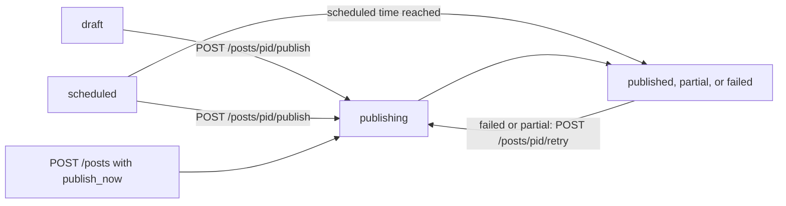

Publishing through SocialAPI is asynchronous: an HTTP success means SocialAPI accepted the post, not that every platform has published it. The post has a `status`, and each platform it goes to is a target in `targets[]` with its own `status`, `platform_post_id`, `permalink`, and `error`. Read them with `GET /v1/posts/{pid}` or receive them in the `post.published`, `post.partial`, and `post.failed` webhook events.

## Endpoints

| Method | Path | Description |
|---|---|---|
| `GET` | `/v1/posts/{pid}` | Read one post with its `status` and `targets[]` |
| `GET` | `/v1/posts` | List posts with their targets |
| `POST` | `/v1/posts/{pid}/publish` | Publish a `draft` or `scheduled` post now |
| `POST` | `/v1/posts/{pid}/retry` | Re-send the failed targets of a `failed` or `partial` post |
| `POST` | `/v1/posts/{pid}/unpublish` | Remove the published copies from the platforms and keep the post |
| `DELETE` | `/v1/posts/{pid}` | Delete a post |
| `POST` | `/v1/media/{id}/verify` | Verify uploaded media before it publishes |

## Publish and read the result

Publish to 2 targets at once:

```bash
curl -X POST https://api.social-api.ai/v1/posts \
  -H "Authorization: Bearer $SOCAPI_KEY" \
  -H "Content-Type: application/json" \
  -d '{
    "text": "Spring sale starts today: https://example.com/spring",
    "publish_now": true,
    "targets": [
      {"account_id": "acc_01HZ9X3Q4R5M6N7P8V2K0W1J"},
      {"account_id": "acc_01HZ9X4T6B8C2D5F7G9H1J3K", "page_id": "sapi_page_01HZ9X5V7C9D3E6G8H1J4K2M"}
    ]
  }'
```

Response (HTTP 201):

```json
{
  "id": "7c9e6679-7425-40de-944b-e07fc1f90ae7",
  "text": "Spring sale starts today: https://example.com/spring",
  "status": "publishing",
  "hidden": false,
  "retry_count": 0,
  "created_at": "2026-10-13T09:00:00Z",
  "updated_at": "2026-10-13T09:00:00Z",
  "targets": [
    {
      "account_id": "acc_01HZ9X3Q4R5M6N7P8V2K0W1J",
      "platform": "threads",
      "status": "publishing"
    },
    {
      "account_id": "acc_01HZ9X4T6B8C2D5F7G9H1J3K",
      "page_id": "sapi_page_01HZ9X5V7C9D3E6G8H1J4K2M",
      "platform": "facebook",
      "status": "publishing"
    }
  ]
}
```

The post is `publishing` and each target is `pending` or `publishing`, because delivery runs after the response. Read the post again until its status is `published`, `partial`, or `failed`, or wait for the webhook:

```bash
curl https://api.social-api.ai/v1/posts/7c9e6679-7425-40de-944b-e07fc1f90ae7 \
  -H "Authorization: Bearer $SOCAPI_KEY"
```

Response (HTTP 200) after the Threads target published and the Facebook target failed:

```json
{
  "id": "7c9e6679-7425-40de-944b-e07fc1f90ae7",
  "text": "Spring sale starts today: https://example.com/spring",
  "status": "partial",
  "hidden": false,
  "retry_count": 0,
  "published_at": "2026-10-13T09:00:04Z",
  "created_at": "2026-10-13T09:00:00Z",
  "updated_at": "2026-10-13T09:00:05Z",
  "targets": [
    {
      "account_id": "acc_01HZ9X3Q4R5M6N7P8V2K0W1J",
      "platform": "threads",
      "status": "published",
      "platform_post_id": "18012345678901234",
      "permalink": "https://www.threads.com/@acme/post/DAbCdEf123",
      "published_at": "2026-10-13T09:00:04Z"
    },
    {
      "account_id": "acc_01HZ9X4T6B8C2D5F7G9H1J3K",
      "page_id": "sapi_page_01HZ9X5V7C9D3E6G8H1J4K2M",
      "platform": "facebook",
      "status": "failed",
      "error": {
        "code": "platform.facebook.rate_limit",
        "message": "Platform rate limit exceeded",
        "category": "rate_limit",
        "caused_by": "platform"
      }
    }
  ]
}
```

The post is `partial`: 1 target published and 1 failed. `POST /v1/posts/{pid}/retry` re-sends only the failed targets.

## Response codes

`POST /v1/posts` and `POST /v1/posts/{pid}/publish` return the post object with one of these HTTP statuses:

| HTTP status | Post `status` | Meaning |
|---|---|---|
| 201 | `draft`, `scheduled`, or `publishing` | SocialAPI created the post. With `publish_now` or `POST /v1/posts/{pid}/publish`, delivery continues in the background |
| 207 | `partial` | Some targets published and others failed before the response was built |
| 422 | `failed` | Every target failed before the response was built. The body is the post object, not an error envelope |

207 and 422 appear only when delivery finishes before SocialAPI builds the response. Do not rely on them: read `status` and each target's `status` on every response, whatever the HTTP status.

`POST /v1/posts/{pid}/retry` returns `200` with `{"success": true}`, and the post goes back to `publishing`. Other statuses on these endpoints are errors in the standard envelope: `400 publishing.validation_failed` when the post fails validation (the issues are in `error.meta.issues`), `409 resource.conflict` for duplicate content, `409 post.state_invalid` when the post is not in a state the endpoint accepts, `400 publishing.no_targets` when the post has no publishable targets, `400 post.no_retryable_deliveries` when a retry finds no failed target, and `429 publishing.velocity_limit` or `429 validation.post_limit_exhausted`. See [Errors](/guides/errors).

SocialAPI ignores request fields it does not recognize, so a misspelled field is not an error: the post is created without it. Send only the documented field names, and read the post back with `GET /v1/posts/{pid}` when a missing field would be costly.

## Post status

A post has one of these statuses. SocialAPI derives it from the statuses of the post's targets.

| Status | Meaning |
|---|---|
| `draft` | Saved without `publish_now` or `scheduled_at`. Nothing is sent until you publish or schedule it |
| `scheduled` | The post is waiting for its scheduled time, or SocialAPI is sending it, until every target settles. While it waits, every target is `pending` |
| `publishing` | A post published now (`publish_now` or `POST /v1/posts/{pid}/publish`) has at least one target `publishing`, or some targets finished while others are still `pending` |
| `published` | Every target is `published` |
| `partial` | At least one target is `published`, and at least one other target is `failed` or `unpublished` |
| `failed` | No target is `published`, and at least one target is `failed` |
| `cancelled` | Every target was `unpublished` |



A draft or scheduled post moves to `publishing` when you publish it. A post that is `published`, `partial`, or `failed` stays in that status until you retry, unpublish, or delete it.

SocialAPI sends one `post.published`, `post.partial`, or `post.failed` event when the post reaches that status. See [Webhook events](/guides/webhook-events).

## Target fields

Each item of `targets[]` is the delivery of the post to one connected account, and one Facebook Page or Pinterest board when the account has more than one.

| Field | Description |
|---|---|
| `account_id` | The connected account |
| `page_id` | The `sapi_page_` ID of the Facebook Page or other page-level destination. Absent when the account has none |
| `board_id` | The board for a Pinterest target. Absent on other platforms |
| `platform` | The platform slug, for example `instagram` or `threads` |
| `media_type` | The content type: `feed`, `reel`, `stories`, or `carousel` |
| `status` | `pending`, `publishing`, `published`, `failed`, or `unpublished` |
| `text`, `title`, `media`, `first_comment`, `visibility`, `scheduled_at` | The values for this target when they differ from the post's own |
| `platform_post_id` | The platform's ID of the published post. Absent until the target is `published` |
| `permalink` | The URL of the published post. Absent until the target is `published` |
| `published_at` | When the target published (ISO 8601, UTC) |
| `error` | Why the target failed. Present only when `status` is `failed`. See [Target errors](#target-errors) |
| `metrics`, `metrics_synced_at` | Engagement numbers and when they were last read. See [Analytics](/guides/analytics) |
| `settings`, `platform_media` | What Instagram or Facebook reports for the published post. See the platform's publishing page |
| `metadata` | Platform-specific key-value data for the target |

Target `status` means:

| Target status | Meaning |
|---|---|
| `pending` | Waiting to be sent: scheduled for later, or queued |
| `publishing` | Being sent, or sent and waiting for the platform to confirm |
| `published` | The platform confirmed the post |
| `failed` | The platform or SocialAPI refused or could not send it. `error` says why |
| `unpublished` | You deleted it from the platform with `DELETE /v1/posts/{pid}` or `POST /v1/posts/{pid}/unpublish` |

On TikTok, the platform can confirm a post before it reports the post's ID. The target is then `published` with no `platform_post_id` and no `permalink`, and both appear after SocialAPI checks again.

SocialAPI sets a target to `failed` with `system.internal` when it stays in `publishing` for more than 1 hour without a final answer from the platform, or for more than 2 hours when the platform keeps reporting it as in progress.

## Target errors

A failed target carries an `error` object with 4 fields:

| Field | Description |
|---|---|
| `code` | The error code. Match on this, never on `message` |
| `message` | A description of what failed |
| `category` | `validation`, `auth`, `account`, `billing`, `resource`, `rate_limit`, `platform`, or `system` |
| `caused_by` | `user` (the request or your connection caused it), `platform` (the platform refused it), or `system` (SocialAPI failed) |

Surface `error.message` to your users instead of a generic retry prompt. Target errors appear in 2 places:

- **`targets[].error`** on every post response: `POST /v1/posts`, `POST /v1/posts/{pid}/publish`, `GET /v1/posts`, and `GET /v1/posts/{pid}`.
- **`results[].error`** in the `post.partial` and `post.failed` webhook events. The payload is `{post_id, status, results}`, and each item of `results` has `account_id`, `page_id`, `platform`, `status`, `platform_post_id`, `permalink`, and `error`. The webhook `error` holds `code` and `message` only.

Target errors do not appear in `GET /v1/events`: an event has `error_message` and `error_category`, with no `error_code`.

These codes describe delivery itself. A failure that comes from the platform has a `platform.{platform}.*` code described on the platform's page.

- `publishing.delivery.account_load_failed`: SocialAPI could not load the connected account when it started sending. Reconnect the account.
- `publishing.delivery.page_resolve_failed`: SocialAPI could not resolve the Facebook Page for the target.
- `publishing.delivery.timeout`: sending did not finish before SocialAPI's time limit for one delivery (15 minutes).
- `validation.publish`: a scheduled post failed validation when its time arrived. `error.message` names the problem. SocialAPI does not retry it.
- `platform.{platform}.publish_failed`: the platform failed the request without a more specific code.
- `system.internal`: SocialAPI stopped waiting for a stuck target (see above).

Retry a failed or partial post with `POST /v1/posts/{pid}/retry`. It re-sends only the failed targets, resets them to `pending`, clears their errors, and costs 1 post credit. See [Plans and usage](/guides/plans#what-counts-as-a-post-or-interaction).

## Verify media before you publish

Media uploaded with the presigned flow has a status, and only `ready` media publishes. A media file is `pending` until you call `POST /v1/media/{id}/verify`, `ready` after verification, and `failed` when the file is missing or the upload would exceed your [storage quota](/guides/plans#plan-allowances).

When you publish or schedule a post that references media that is not `ready`, `POST /v1/posts` returns `400 publishing.validation_failed`, and `error.meta.issues` contains an issue for field `media` with the message `media {id} is not ready or not found`. Draft posts skip this check and run it when you publish. With `skip_validation: true`, the post is accepted and the target fails at delivery. See [Media](/guides/media) for the upload flow.

## Delete a post

`DELETE /v1/posts/{pid}` returns HTTP 200, not 204. What it does depends on the post's status:

| Post status | What happens |
|---|---|
| `draft`, `failed`, or `cancelled` | SocialAPI deletes the post. Nothing was published |
| `scheduled` | SocialAPI cancels the scheduled sends and deletes the post |
| `published` or `partial` | SocialAPI deletes each published target from its platform. SocialAPI deletes the post only when no target is still `published`. Otherwise it keeps the post, and its `status` is recalculated |
| `publishing` | Returns `409 post.state_invalid`. Wait for a final status |

Response (HTTP 200) for a post published to Threads and TikTok, when Threads removed its copy and TikTok cannot delete posts:

```json
{
  "success": true,
  "deleted": false,
  "results": [
    {
      "platform": "threads",
      "account_id": "acc_01HZ9X3Q4R5M6N7P8V2K0W1J",
      "outcome": "deleted"
    },
    {
      "platform": "tiktok",
      "account_id": "acc_01HZ9X6W8D1E4F7H9J2K5L3N",
      "outcome": "not_supported",
      "message": "Operation not supported for this platform"
    }
  ]
}
```

| Field | Description |
|---|---|
| `success` | `true` whenever the request was processed, even when a platform kept its copy. Read `deleted` and `results` |
| `deleted` | `true` when SocialAPI removed the post. `false` when at least one platform copy is still live and SocialAPI kept the post |
| `results[].outcome` | `deleted`, `not_supported` (the platform cannot delete posts through its API), or `failed` |
| `results[].message` | The reason for `not_supported` or `failed` |

A target the platform did not delete stays `published`, so SocialAPI shows what is still live. Deleting a post costs no credits and sends `post.deleted` when SocialAPI removes the post.

`POST /v1/posts/{pid}/unpublish` removes the published copies from the platforms and keeps the post. Send `{"account_id": "..."}` to remove one target only. Targets removed from the platform become `unpublished`. The post is `partial` while another target is still `published`, `failed` when none is published and one target failed, and `cancelled` when every target was removed. It returns `400 validation.field_invalid` when there is no published target to remove, and `501 resource.not_supported` when every remaining platform cannot delete posts. SocialAPI sends `post.unpublished` when at least one target is removed. See [Platform support](/platforms/overview) for what each platform can delete.

## Scopes

| Scope | Grants |
|---|---|
| `posts:read` | List and read posts and their targets |
| `posts:write` | Publish, retry, unpublish, and delete posts |
| `media:write` | Verify uploaded media |

See [Scoped API keys](/guides/scoped-keys).

## Use from an AI agent

| Tool | What it does |
|---|---|
| `social_api_create_post` | Creates, schedules, or publishes a post |
| `social_api_get_post` | Reads a post with its targets |
| `social_api_publish_post` | Publishes a draft or scheduled post now |
| `social_api_retry_post` | Re-sends the failed targets |
| `social_api_delete_post` | Deletes or cancels a post |
| `social_api_unpublish_post` | Removes the published copies and keeps the post |
| `social_api_validate_post` | Checks a post without sending it |

## Related

- [Publish a post](/guides/publishing): fields every platform shares and how to create a post
- [Schedule posts](/guides/scheduling): schedule a post and cancel it
- [Upload media](/guides/media): upload, verify, and attach media
- [Webhook events](/guides/webhook-events): `post.published`, `post.partial`, and `post.failed` payloads
- [Errors](/guides/errors): every error code with its HTTP status
- [Rate limits](/guides/rate-limits): posting velocity caps that hold or refuse a publish
