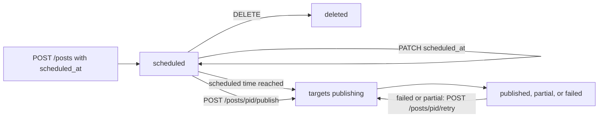

Scheduling publishes a post at a time you choose. Send `scheduled_at` with `POST /v1/posts`, and SocialAPI holds the post and sends it to each target when the time arrives. Every platform accepts `scheduled_at`: SocialAPI does the waiting, not the platform.

A scheduled post costs 1 post credit when you create it, whatever the number of targets. Editing and cancelling cost nothing. See [Plans and usage](/guides/plans#what-counts-as-a-post-or-interaction).

## Endpoints

| Method | Path | Description |
|---|---|---|
| `POST` | `/v1/posts` | Schedule a post with `scheduled_at` |
| `GET` | `/v1/posts?status=scheduled` | List scheduled posts |
| `PATCH` | `/v1/posts/{pid}` | Change the time, content, or targets of a scheduled post |
| `POST` | `/v1/posts/{pid}/publish` | Publish a scheduled post now |
| `DELETE` | `/v1/posts/{pid}` | Cancel a scheduled post |

## Schedule a post

Set `scheduled_at` to an RFC 3339 time in the future and name at least one target:

```bash
curl -X POST https://api.social-api.ai/v1/posts \
  -H "Authorization: Bearer $SOCAPI_KEY" \
  -H "Content-Type: application/json" \
  -d '{
    "text": "Launching today: https://example.com/launch",
    "scheduled_at": "2026-10-20T09:00:00Z",
    "targets": [
      {"account_id": "acc_01HZ9X3Q4R5M6N7P8V2K0W1J"},
      {"account_id": "acc_01HZ9X4T6B8C2D5F7G9H1J3K", "page_id": "sapi_page_01HZ9X5V7C9D3E6G8H1J4K2M"}
    ]
  }'
```

Response (HTTP 201):

```json
{
  "id": "7c9e6679-7425-40de-944b-e07fc1f90ae7",
  "text": "Launching today: https://example.com/launch",
  "status": "scheduled",
  "scheduled_at": "2026-10-20T09:00:00Z",
  "hidden": false,
  "retry_count": 0,
  "created_at": "2026-10-13T09:00:00Z",
  "updated_at": "2026-10-13T09:00:00Z",
  "targets": [
    {
      "account_id": "acc_01HZ9X3Q4R5M6N7P8V2K0W1J",
      "platform": "threads",
      "status": "pending",
      "scheduled_at": "2026-10-20T09:00:00Z"
    },
    {
      "account_id": "acc_01HZ9X4T6B8C2D5F7G9H1J3K",
      "page_id": "sapi_page_01HZ9X5V7C9D3E6G8H1J4K2M",
      "platform": "facebook",
      "status": "pending",
      "scheduled_at": "2026-10-20T09:00:00Z"
    }
  ]
}
```

The post is `scheduled` and each target is `pending`. SocialAPI sends `post.scheduled` when the post is created.

- **Time:** with at least one target, a `scheduled_at` in the past returns `400 validation.field_invalid`. With no targets, the post is saved as a draft. A value that is not RFC 3339 returns `400 validation.field_invalid`. Include the UTC offset or `Z`.
- **One time per target:** a target can set its own `scheduled_at`, which overrides the post's. The post's `scheduled_at` is the earliest of them.
- **Without targets:** a post with no targets is saved as a draft, even with `scheduled_at`.
- **Both flags:** when you send `publish_now` and `scheduled_at` together, the post is scheduled.
- **Validation:** SocialAPI validates the post when you schedule it, so a violation returns `400 publishing.validation_failed` immediately, and validates the post again when its time arrives.
- **Allowance:** at the post allowance, scheduling returns `429 validation.post_limit_exhausted` and creates nothing.

## How a scheduled post moves through statuses



A scheduled post keeps the status `scheduled` while it waits for its time and while SocialAPI sends it, until every target has settled. While SocialAPI sends it, each target shows `publishing`. The post then becomes `published`, `partial`, or `failed`, and SocialAPI sends one `post.published`, `post.partial`, or `post.failed` event. The statuses and the per-target fields are in [Track post delivery](/guides/delivery#post-status).

## Edit or reschedule

`PATCH /v1/posts/{pid}` changes a `scheduled` post. A new time or target list takes effect at once.

```bash
curl -X PATCH https://api.social-api.ai/v1/posts/7c9e6679-7425-40de-944b-e07fc1f90ae7 \
  -H "Authorization: Bearer $SOCAPI_KEY" \
  -H "Content-Type: application/json" \
  -d '{"scheduled_at": "2026-10-21T14:00:00Z"}'
```

The response is HTTP 200 with the updated post. SocialAPI sends `post.updated` with `changed_fields`. An edit to the content or targets runs validation again. A post in any status other than `draft`, `scheduled`, or `failed` returns `409 post.state_invalid`. [Publish a post](/guides/publishing#edit-a-post-before-it-publishes) lists every editable field.

## Publish now

`POST /v1/posts/{pid}/publish` sends a scheduled post immediately. It costs 1 post credit again, on top of the credit the scheduling cost. The response is HTTP 201 and the post is `publishing`. A post that is `published`, `partial`, or `failed` returns `409 post.state_invalid`.

## Cancel a scheduled post

`DELETE /v1/posts/{pid}` cancels a `scheduled` post: SocialAPI removes the post and sends nothing. The response is HTTP 200 with `{"success": true, "deleted": true}`, and SocialAPI sends `post.deleted`. The post credit is not returned. Deleting a post that is already `publishing` returns `409 post.state_invalid`. See [Delete a post](/guides/delivery#delete-a-post).

## Posting caps can delay a scheduled post

SocialAPI caps how many posts one account publishes per hour and per 24 hours, by platform. A scheduled post that reaches a cap is not failed. The target stays `pending`, and SocialAPI publishes it when the cap window clears, so the post goes out later than `scheduled_at`. The caps and their values are in [Rate limits](/guides/rate-limits#posting-velocity-caps). Immediate publishes that reach a cap return `429 publishing.velocity_limit` instead.

## When a scheduled post fails

SocialAPI makes one delivery attempt per target at the scheduled time. A failed attempt is final: the target becomes `failed` with its `error`, the post becomes `failed` or `partial`, and SocialAPI sends one `post.failed` or `post.partial` event. Nothing is re-sent automatically. A scheduled post's credit is not returned when it fails.

Common causes are a disconnected account (`publishing.delivery.account_load_failed`), an account that lost the `posts.write` [permission](/guides/permissions) (`account.permission_missing`), content that stopped passing validation (`validation.publish`), and a platform refusal (`platform.{platform}.*`). The causes are in [Track post delivery](/guides/delivery#target-errors).

To send a failed post again, fix the cause, optionally edit the post, and call `POST /v1/posts/{pid}/retry`. It re-sends only the failed targets and costs 1 post credit.

A scheduled post still publishes when your SocialAPI account is past due. See [Past-due accounts](/guides/plans#past-due-accounts).

## YouTube has 2 schedulers

On YouTube, `scheduled_at` makes SocialAPI upload the video at that time, and `platform_data.youtube.publish_at` uploads it now and lets YouTube make it public later. See [Schedule a YouTube post](/platforms/youtube/publishing#schedule-a-post).

## Read scheduling support from the API

`GET /v1/posts/validate` returns `scheduling.supported` for each platform it covers. It is `true` for each of them. See [Publish a post](/guides/publishing#validate-before-you-publish).

## Scopes

| Scope | Grants |
|---|---|
| `posts:read` | List scheduled posts |
| `posts:write` | Schedule, edit, publish now, and cancel posts |

## Use from an AI agent

| Tool | What it does |
|---|---|
| `social_api_create_post` | Schedules a post with `scheduled_at` |
| `social_api_list_posts` | Lists posts, including `status=scheduled` |
| `social_api_update_post` | Changes the time or content of a scheduled post |
| `social_api_publish_post` | Publishes a scheduled post now |
| `social_api_delete_post` | Cancels a scheduled post |

## Related

- [Publish a post](/guides/publishing): fields every platform shares
- [Track post delivery](/guides/delivery): post statuses, target errors, and retry
- [Rate limits](/guides/rate-limits): the posting caps that hold a scheduled post
- [Plans and usage](/guides/plans): what scheduling costs
- [Webhook events](/guides/webhook-events): `post.scheduled` and the settle events
