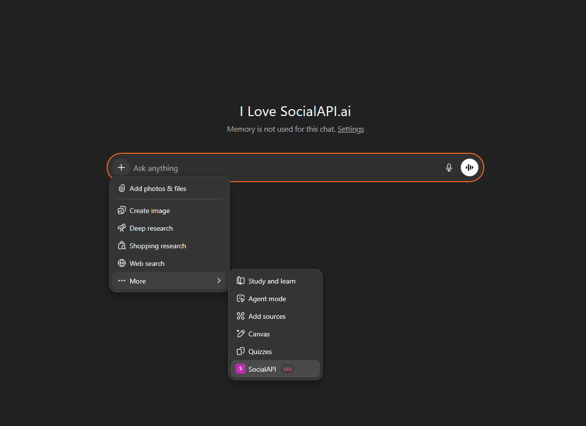

Connect SocialAPI to ChatGPT and ask it to list your connected accounts, reply to comments, send direct messages (DMs), and publish posts. SocialAPI is listed in ChatGPT's plugin directory as **Post Schedule DMs by SocialAPI**. ChatGPT connects to SocialAPI's MCP server at `https://api.social-api.ai/mcp` and signs in with OAuth 2.1, so you create no API key and type no server URL.

## Prerequisites

- A SocialAPI account with at least one connected account.
- A ChatGPT account on any plan, Free included, in any region. In a Business, Enterprise, or Edu workspace that requires approval for plugins, an administrator must approve SocialAPI first.

## Set up

The steps are the same on chatgpt.com, the ChatGPT desktop app, and the ChatGPT mobile app (iOS and Android).

<Steps>
  <Step title="Open the plugin directory">
    Select **Plugins** in the sidebar. You can also go to **Settings** → **Plugins**. Older versions of the mobile app show **Apps** instead of **Plugins**.
  </Step>
  <Step title="Install SocialAPI">
    Search for **SocialAPI**, open **Post Schedule DMs by SocialAPI**, and select **Install plugin**. Then select **Connect**.
  </Step>
  <Step title="Authorize with your SocialAPI account">
    A browser window opens on the SocialAPI authorization page. Log in and click **Authorize**.

    
  </Step>
  <Step title="Use it in a conversation">
    Type `@` and pick SocialAPI, or click **+** near the message box and select it. Some ChatGPT interfaces place it under **More**.
  </Step>
</Steps>

## Try it

Ask ChatGPT:

```text
List my connected social accounts
```

ChatGPT calls `social_api_list_accounts` and answers with your connected accounts and their platforms. Depending on your app permission setting in ChatGPT, ChatGPT asks you to approve a tool call before it runs.

## Troubleshooting

<AccordionGroup>
  <Accordion title="The plugin shows Admin approval required">
    Your workspace does not let members install this plugin without approval. Ask a workspace administrator to review and enable it. The message does not mean a request was sent.
  </Accordion>
  <Accordion title="Search does not find SocialAPI">
    Check that you are signed in to the intended ChatGPT account or workspace. In a managed workspace, the administrator controls which plugins members can find and install.
  </Accordion>
  <Accordion title="SocialAPI is installed but ChatGPT does not use it">
    Start a new conversation and select SocialAPI with `@` or the **+** menu, then ask for a specific task such as listing your accounts.
  </Accordion>
  <Accordion title="Tool calls fail with HTTP 401">
    The OAuth session expired. Go to **Settings** → **Plugins**, open **Post Schedule DMs by SocialAPI**, and select **Reconnect**. If **Reconnect** is not shown, open the **•••** menu, select **Disconnect**, then select **Connect**.
  </Accordion>
</AccordionGroup>

## Related

- [SocialAPI MCP server](/integrations/overview): the server URL and the other supported clients.
- [MCP tools reference](/integrations/tools): every tool ChatGPT can call.
- [OAuth for MCP clients](/integrations/oauth): how the sign-in works.
- [Errors](/guides/errors): every error code a tool can return.
- [Connected apps in ChatGPT](https://help.openai.com/en/articles/11487775-connected-apps-in-chatgpt): OpenAI's guide to installing and managing plugins and apps.
